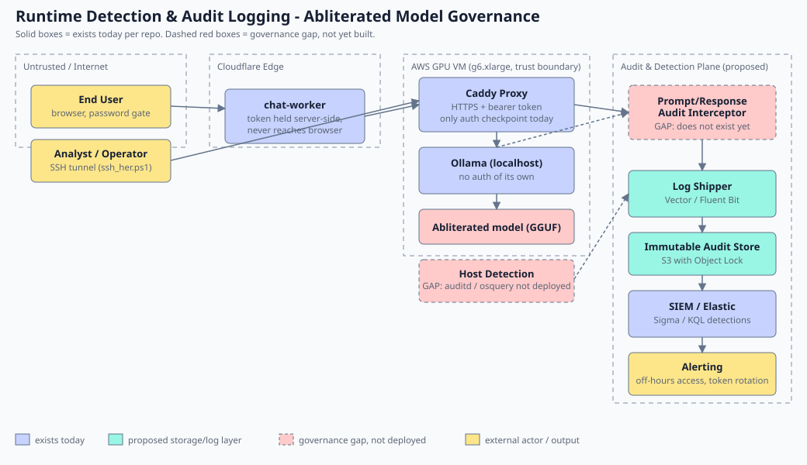

# zd_abliteration_model

A private AI model with the "I can't help with that" surgically removed, running
on a GPU so massive it trumps the cost of a mortgage if you leave it running. You
turn it on when you need it, off when you don't, and it costs about the same as a
few coffees a month if you're disciplined about the off part.

## What's in the box

Three moving pieces, stacked:

- `setup_heretic.sh` installs Ollama and pulls the model onto the GPU box. This
  is the "make it work at all" layer. You reach it privately over an SSH tunnel.
- `setup_proxy.sh` bolts an authenticated HTTPS front door (Caddy) onto Ollama,
  which has exactly zero authentication of its own and should never face the
  internet naked. Now one outside person can use the model with a bearer token,
  while Ollama stays safely on localhost where it belongs.
- `chat-worker/` is a Cloudflare Worker that serves a password-gated chat page
  and forwards to the box. The token lives server-side in the Worker, so nobody's
  browser ever sees it. This is the "give a human a URL and a password" layer.

You do not need all three. Layer one is enough to use it yourself. Add two if
someone else needs API access. Add three if that someone would rather have a chat
box than write curl commands.

## The 27B with a chat window (current build)

The 20B was slow and the answers were thin, so the current build is
`huihui_ai/Qwen3.8-abliterated:27b-q4_K_M` (18 GB, Apache 2.0, from huihui-ai)
with Open WebUI as a typed chat window. One script does all of it:
`setup_qwen27b_chat.sh`. It installs the NVIDIA driver and Docker only if they
are missing, puts Ollama and the chat app on localhost only, pulls the model, and
proves it answers. No public ports, no login screen, no proxy. You get in through
an SSH tunnel, which is the lock.

1. Launch a g6.xlarge on the Deep Learning Base OSS Nvidia Driver GPU AMI
   (Ubuntu), 100 GB gp3, key pair named `gpu-box-key`, security group with SSH
   from your IP only. Pin an Elastic IP.
2. On your Mac, run `mac_tunnel_setup.sh` once and type the Elastic IP when it
   asks. It adds an `ssh heretic` shortcut that also opens the tunnel. On
   Windows, `ssh_her.ps1` now forwards the chat port too.
3. `ssh heretic`, then on the box:

       cd /tmp && curl -fsSL https://raw.githubusercontent.com/zeiddata-dev/zd_ai_model_abliteration_broken_governance/main/setup_qwen27b_chat.sh -o /tmp/setup_qwen27b_chat.sh && bash /tmp/setup_qwen27b_chat.sh

   Wait for `DECISION=READY`. The 18 GB download is the slow part.
4. Leave that SSH session open and go to http://localhost:3000 in your browser.
   Type. That's it.

Fallback with no browser: `ollama run huihui_ai/Qwen3.8-abliterated:27b-q4_K_M`
on the box. Ollama runs with a 32K context, flash attention and a q8_0 KV cache
so the whole thing stays on the L4. If `DECISION=READY_CHECK_GPU` shows up, the
model spilled onto the CPU: set `CTX=16384` at the top of the script and re-run.

The older layers below (`setup_proxy.sh`, `chat-worker/`) still point at the 20B
model name. Change `MODEL` in them before using them with this build.

## Files

- `setup_qwen27b_chat.sh` current build: 27B model plus Open WebUI chat window, runs on the box
- `mac_tunnel_setup.sh` one-time Mac setup for the `ssh heretic` tunnel shortcut
- `setup_heretic.sh` model install and smoke test, runs on the box (original 20B build)
- `setup_proxy.sh` authenticated HTTPS proxy in front of Ollama, runs on the box
- `ssh_her.ps1` PowerShell shortcut that SSHes in and opens the tunnels (chat on 3000, API on 11434) in one word
- `USAGE.md` how to actually use the thing, plus a plain-English take on what
  abliteration is
- `HANDOFF.md` the copy-paste kit you send to whoever gets API access
- `RUNBOOK.md` the full build, start to finish, for when future-you has forgotten
  all of this
- `chat-worker/` the Cloudflare Worker chat front end

## Quick start

1. Launch a g6.xlarge on the Deep Learning Base OSS Nvidia Driver GPU AMI
   (Ubuntu 22.04), 80 GB disk, SSH locked to your IP. This AMI ships with the GPU
   driver already installed, which saves you an afternoon of driver misery.
2. Pin an Elastic IP to the box so its address survives a stop/start. Skip this
   and the address changes every time you turn it off, and every shortcut you
   built breaks. Ask how I know.
3. On the box, run `setup_heretic.sh` and wait for `DECISION=READY`.
4. For outside access, add a DNS A record, open ports 80 and 443, set the domain
   in `setup_proxy.sh`, and run it.

`RUNBOOK.md` has the version with all the footnotes.

## What it costs

The GPU is about 80 cents an hour. The math from there is entirely about
willpower:

- On 24/7: roughly $590/month. Don't. There is no reason for this box to run
  while you sleep.
- On a few hours a day, off the rest: roughly $70/month.
- The 80 GB disk: about $6/month, and it charges even while the box is off,
  because the disk is still sitting there holding your model.
- The Elastic IP: free while the box runs, about $3 to $4/month while it's
  stopped. That's the toll for a permanent address.

The single biggest lever on your bill is a boring one: stop the instance when
you're done. Compute billing stops, the disk keeps your setup, and it's back in
about a minute.

## A few things that will save you grief

- Ollama has no authentication. None. Keep it on localhost and let the proxy do
  the door-guarding. Exposing port 11434 to the internet is handing out an open
  pipe to a GPU you're paying for.
- The token is the access control. Rotate it by re-running `setup_proxy.sh`. Kill
  outside access instantly with `sudo systemctl stop caddy`.
- This is an abliterated model. The refusal filter is gone, so it will take a
  swing at anything you ask. Whatever comes out of it traces back to your
  infrastructure, which makes deciding what to ask your job, not the model's.
- Never commit keys, `.pem` files, tokens, or the `heretic_proxy.env` pointer.
  The `.gitignore` already blocks them. Don't fight it.
